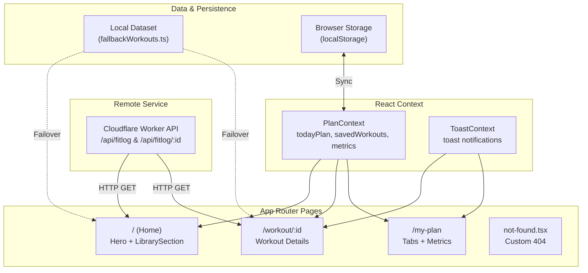

<div align="center">

# FitLog

### TRAIN WITH INTENT. LOG EVERY SET.

A dark-themed workout library and daily training log built with Next.js 16 App Router, React 19, and Tailwind CSS v4. Browse foundational gym lifts, inspect technical execution guides, add exercises to a capped five-lift daily routine or a saved list, and monitor training volume in real time.

<br />

[](https://fitlog-workouts.netlify.app/)
[](https://nextjs.org/)
[](https://react.dev/)
[](https://www.typescriptlang.org/)
[](https://tailwindcss.com/)

<br />

<p align="center">
  <a href="#demo">Demo</a> •
  <a href="#links">Links</a> •
  <a href="#overview">Overview</a> •
  <a href="#key-features">Key Features</a> •
  <a href="#architecture">Architecture</a> •
  <a href="#tech-stack">Tech Stack</a> •
  <a href="#project-structure">Project Structure</a> •
  <a href="#api-reference">API Reference</a> •
  <a href="#getting-started">Getting Started</a>
</p>

</div>

---

## 🎬 Demo

<div align="center">
  <a href="https://fitlog-workouts.netlify.app/">
    
  </a>
  <p><em>Demonstration showing library sorting, workout inspection, adding to today's plan, live metrics updating on /my-plan, and set completion.</em></p>
</div>

---

## 🔗 Links

| Resource | URL | Description |
| :--- | :--- | :--- |
| Live Application | [fitlog-workouts.netlify.app](https://fitlog-workouts.netlify.app/) | Production deployment hosted on Netlify |
| GitHub Repository | [github.com/mahfuzhasan2700/Assignment-6](https://github.com/mahfuzhasan2700/Assignment-6) | Source code repository and commit history |
| Worker API | [api.abcz.workers.dev/api/fitlog](https://api.abcz.workers.dev/api/fitlog) | Cloudflare Worker REST API for workout data |
| UI Design Files | [UI/Fit Log.fig](UI/Fit%20Log.fig) • [UI/Fit Log.penpot](UI/Fit%20Log.penpot) | Figma and Penpot workspace design files |

---

## 📖 Overview

Most workout tracking applications require user accounts, subscription tiers, and multi-step forms for basic logging. FitLog removes that friction with a focused, client-first interface designed for fast exercise selection and daily volume tracking in low-light gym environments.

The workflow centers around an intentional five-lift daily workbench. Users select lifts from an anatomical library, inspect four-step execution cues, monitor live aggregations for active duration and caloric burn, and mark sets completed during training sessions.

---

## ✨ Key Features

1. **Workout Library and Multi-Attribute Sorting**
   - Displays 12 foundational gym exercises covering Chest, Back, Legs, Arms, Core, Shoulders, and Full Body groups.
   - Dynamic sorting menu reorders the grid by Duration (descending minutes), Calories Burned (descending kcal), or User Rating without page refreshes.
   - Cards display category tags, equipment specifications, and a three-point metrics row.

2. **Two-Column Workout Detail View**
   - Individualized `/workout/[id]` routes rendering full-height exercise illustrations on the left and technical specifications on the right.
   - Key specifications panel displaying equipment, difficulty, sets, reps, duration, calories burned, and user rating.
   - Numbered four-step instructions detailing setup, unrack/grip, execution range of motion, and safety rules.
   - Action buttons to add to today's plan or save for later with duplicate detection and toast feedback.

3. **Live Telemetry Dashboard (`/my-plan`)**
   - Three summary cards compute active exercises count, total estimated minutes, and projected caloric expenditure.
   - Derived calculations update immediately through memoized selectors upon adding, removing, or toggling exercises.
   - Animated visual progress bar displays active routine size against the daily five-lift cap.

4. **Dual-Tab Organization and Volume Cap**
   - Tabbed navigation toggles between Today's Plan and Saved routines with persistent count indicators.
   - Enforces a five-lift limit on Today's Plan to prevent overtraining, displaying warning notifications if the cap is reached.
   - Dedicated placeholder states with direct navigation buttons when lists are empty.

5. **Completion Logging, Removal, and Reset**
   - Completion toggle applies visual strike-through styling, adds an emerald badge, and triggers a canvas-confetti animation.
   - One-click removal button clears individual items with toast notifications.
   - Reset button clears the active daily plan to prepare for a new session.

6. **Fault-Tolerant Hydration and Persistence**
   - Attempts remote API fetching with `{ cache: "no-store" }` and automatically fails over to local dataset if unreachable.
   - Synchronizes active plan and saved lists to browser `localStorage` across page reloads.
   - Fully responsive layout across mobile, tablet, and desktop viewports with a custom gym-themed 404 page for unmatched routes.

---

## 🏗️ Architecture

FitLog uses Next.js App Router for page routing, React Context for state management, and an automated fallback layer for offline resilience.



---

## 🛠️ Tech Stack

| Layer | Technology | Version | Why It Is Used |
| :--- | :--- | :--- | :--- |
| **Framework** | Next.js | `16.3.6` | App Router for dynamic routing (`/workout/[id]`), layouts, and static optimization. |
| **UI Library** | React | `19.2.8` | Concurrent rendering, modern hooks (`useMemo`, `useCallback`, `useContext`), and hydration. |
| **Language** | TypeScript | `5.x` | Static typing for workout entities, context payloads, and component props. |
| **Styling** | Tailwind CSS | `v4.0` | Utility-first CSS via `@tailwindcss/postcss` for dark theme tokens and responsive layouts. |
| **Utilities** | clsx & tailwind-merge | `2.1.1` / `3.0.2` | Conditional class name construction and conflicting utility resolution. |
| **Icons** | Lucide React | `1.16.0` | Lightweight SVG icons for equipment, metrics, and navigation controls. |
| **Interactions** | canvas-confetti | `1.9.4` | Particle celebration triggered when marking exercises completed. |
| **Typography** | Google Fonts via `next/font` | Built-in | Oswald for condensed uppercase headings and Inter for interface legibility. |
| **Deployment** | Netlify | Production | Continuous deployment linked to GitHub with Next.js plugin support via `netlify.toml`. |

---

## 📂 Project Structure

```plaintext
B14-A6-Fit-Log/
├── public/
│   └── assets/                     # Static images (banner, logo)
├── src/
│   ├── app/
│   │   ├── layout.tsx              # Root HTML shell, fonts, and global context providers
│   │   ├── page.tsx                # Home page composing Hero and LibrarySection
│   │   ├── not-found.tsx           # Custom 404 page for unmatched routes
│   │   ├── my-plan/
│   │   │   └── page.tsx            # Daily workbench with telemetry cards and dual tabs
│   │   └── workout/
│   │       └── [id]/
│   │           └── page.tsx        # Dynamic route for 2-column workout detail view
│   ├── components/
│   │   ├── Navbar.tsx              # Sticky header with active route styling and live badges
│   │   ├── Hero.tsx                # Home page banner with CTA anchor and equipment graphic
│   │   ├── LibrarySection.tsx      # Responsive 3x4 workout grid with sorting dropdown
│   │   ├── WorkoutCard.tsx         # Workout card displaying category tags, specs, and link
│   │   ├── EmptyState.tsx          # Reusable placeholder with CTA for empty lists
│   │   └── Footer.tsx              # Brand copyright footer
│   ├── context/
│   │   ├── PlanContext.tsx         # State management for plans, metrics, and localStorage
│   │   └── ToastContext.tsx        # Toast alert notification provider and hook
│   ├── data/
│   │   └── fallbackWorkouts.ts     # Offline resilient workout dataset and API constants
│   └── types/
│       └── workout.ts              # TypeScript interfaces for Workout and SortOption
├── UI/
│   ├── Fit Log.fig                 # Source Figma design file
│   └── Fit Log.penpot              # Cross-platform Penpot design file
├── assets/                         # Repository media (walkthrough GIF, visual assets)
├── netlify.toml                    # Netlify deployment configuration
├── package.json                    # Project dependencies and npm scripts
├── postcss.config.mjs              # PostCSS configuration for Tailwind CSS v4
├── tsconfig.json                   # TypeScript compiler options
└── next.config.ts                  # Next.js configuration
```

---

## 📡 API Reference

The application interfaces with two endpoints provided by a Cloudflare Worker service:

- `GET https://api.abcz.workers.dev/api/fitlog` — Retrieves all 12 exercises.
- `GET https://api.abcz.workers.dev/api/fitlog/:id` — Retrieves a single workout by numeric ID.

### Sample Response Object
```json
{
  "id": 1,
  "name": "Barbell Bench Press",
  "image": "https://img.magnific.com/free-photo/portrait-anime-character-doing-fitness-exercising_23-2151666664.jpg?w=740",
  "muscleGroups": ["Chest", "Arms"],
  "equipment": "Barbell, Bench",
  "difficulty": "Intermediate",
  "duration": 25,
  "caloriesBurned": 180,
  "sets": 4,
  "reps": "6-8",
  "rating": 4.8,
  "description": "A compound press that builds chest thickness, triceps, and pressing power from a stable bench.",
  "instructions": [
    "Lie on the bench with eyes under the bar and feet planted.",
    "Unrack with locked elbows and lower the bar to mid-chest.",
    "Press up in a slight arc until elbows lock without bouncing.",
    "Keep shoulder blades pinched and a natural arch in the back."
  ]
}
```

### Fallback Behavior
1. Every client fetch request is executed with `{ cache: "no-store" }` to request fresh data.
2. If the request fails due to network disruption or returns a non-200 HTTP status, the catch handler intercepts the error.
3. The component hydrates from `fallbackWorkouts.ts` and logs a warning to the browser console, preventing blank screens or unhandled runtime exceptions.

---

## 🎨 Design System

| Token | Hex Value | Application |
| :--- | :--- | :--- |
| **Accent Lime** | `#ccff00` | Primary buttons, active tabs, progress bars, completed badges |
| **Obsidian Dark** | `#090a0d` | Page background, high-contrast text |
| **Dark Graphite** | `#12141a` | Card surfaces, metric dashboard containers |
| **Elevated Surface** | `#181c25` | Secondary action buttons, icon wrappers, hover backgrounds |
| **Graphite Border** | `#1f232b` | Structural dividers, card borders, table rules |
| **Text Primary** | `#ffffff` | Headings, active values, primary labels |
| **Text Muted** | `#9ca3af` | Subtitles, descriptions, secondary specifications |

### Typography
- **Display Font:** `Oswald` (Google Font via `next/font/google`) — Display headings, hero title, and button labels.
- **Interface Font:** `Inter` (Google Font via `next/font/google`) — Body text, instructions, specifications, and data tables.

---

## 🚀 Getting Started

### Prerequisites
- **Node.js:** `v18.17.0` or higher (Node 20+ recommended)
- **Package Manager:** `npm` (included with Node), `pnpm`, or `yarn`
- **Git:** Installed on your local machine

### 1. Clone the Repository
```bash
git clone https://github.com/mahfuzhasan2700/Assignment-6.git
```

### 2. Navigate to Directory
```bash
cd Assignment-6/B14-A6-Fit-Log
```

### 3. Install Dependencies
```bash
npm install
```

### 4. Run the Development Server
```bash
npm run dev
```

Open [http://localhost:3000](http://localhost:3000) in your browser to inspect the application.

### 5. Production Build and Verification
```bash
npm run lint
```

```bash
npm run build
```

```bash
npm start
```

---

## 📱 Responsive Behavior

- **Mobile Viewports (< 640px):** Single-column stacked layouts for the hero section, exercise grid, and detail view. The navbar collapses into a slide-down mobile menu while retaining direct access to plan badges.
- **Tablet Viewports (640px – 1024px):** Library grid reorganizes into 2 columns. The `/my-plan` telemetry cards display side-by-side with proportional padding.
- **Desktop Viewports (> 1024px):** Fixed 3x4 exercise library grid, full two-column detail inspection view with sticky layout support, and full-width navigation header.

---

## 📄 Author and License

- **Author:** Mahfuz Hasan ([@mahfuzhasan2700](https://github.com/mahfuzhasan2700))
- **License:** MIT License. A `LICENSE` file should be added to the repository root.

<br />

<div align="center">
  <sub>© 2026 FitLog — Workout Library. Train hard, log honest.</sub>
</div>