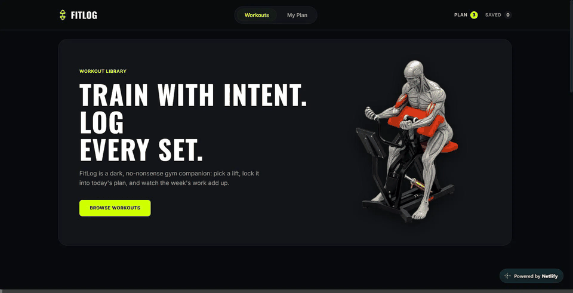
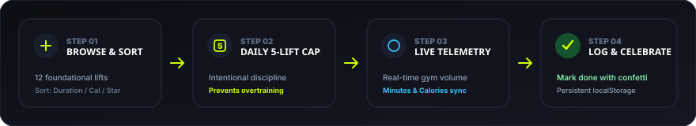
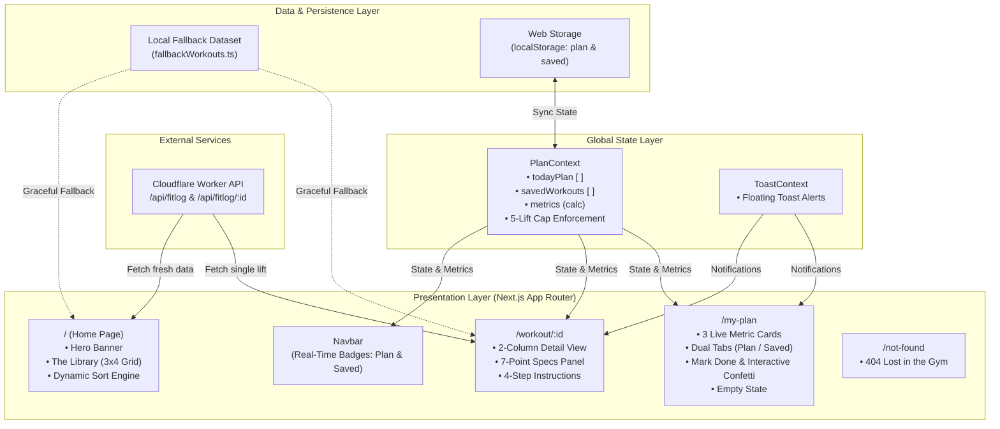

<div align="center">

# 🏋️‍♂️ FITLOG

### **TRAIN WITH INTENT. LOG EVERY SET.**

*A dark, high-performance gym training companion engineered with the Next.js 16 App Router, React 19, and Tailwind CSS v4. Curate your daily routine, lock exercises into a focused 5-lift workbench, monitor duration and caloric expenditure in real time, and celebrate completed sets.*

<br />

[](https://fitlog-workouts.netlify.app/)
[](https://nextjs.org/)
[](https://react.dev/)
[](https://www.typescriptlang.org/)
[](https://tailwindcss.com/)
[](LICENSE)

<br />

<p align="center">
  <a href="#-interactive-product-walkthrough"><strong>🎬 Product Demo</strong></a> •
  <a href="#-product-overview"><strong>📖 Overview</strong></a> •
  <a href="#-training-lifecycle"><strong>🔄 Lifecycle</strong></a> •
  <a href="#-core-capabilities"><strong>⚡ Capabilities</strong></a> •
  <a href="#-key-features"><strong>✨ Features</strong></a> •
  <a href="#-system-architecture"><strong>🏗️ Architecture</strong></a> •
  <a href="#-technology-stack"><strong>🛠️ Tech Stack</strong></a> •
  <a href="#-api-specifications--resilience"><strong>📡 API Specs</strong></a> •
  <a href="#-getting-started"><strong>🚀 Getting Started</strong></a>
</p>

</div>

---

## 🎬 Interactive Product Walkthrough

<div align="center">
  <a href="https://fitlog-workouts.netlify.app/">
    
  </a>
  <p align="center">
    <em>▲ Real-time demonstration: Dynamic sorting by Calories/Rating ➔ Two-column exercise detail inspection ➔ Adding to Today's Plan ➔ Live telemetry recalculation on <code>/my-plan</code> ➔ Set completion checkmark &amp; confetti celebration.</em>
  </p>
</div>

---

## 🔗 Live Deployments & Endpoints

| Resource | URL | Description | Status |
| :--- | :--- | :--- | :--- |
| 🌐 **Production Web Application** | [fitlog-workouts.netlify.app](https://fitlog-workouts.netlify.app/) | Deployed production release hosted on Netlify |  |
| 🐙 **Source Code Repository** | [github.com/mahfuzhasan2700/Assignment-6](https://github.com/mahfuzhasan2700/Assignment-6) | Official GitHub repository |  |
| ⚡ **API Service Endpoint** | [api.abcz.workers.dev/api/fitlog](https://api.abcz.workers.dev/api/fitlog) | Cloudflare Worker REST API service |  |
| 🎨 **Design Source Files** | [Fit Log.fig](UI/Fit%20Log.fig) • [Fit Log.penpot](UI/Fit%20Log.penpot) | Figma and Penpot UI design files |  |

---

## 📖 Product Overview

**FitLog** is an industrial-aesthetic gym training platform engineered for athletes and lifters who demand structured training volume, deliberate exercise selection, and frictionless set tracking.

Traditional fitness apps often overwhelm users with bloated social feeds, mandatory subscription tiers, and convoluted interfaces. FitLog eliminates that friction with a focused, high-contrast obsidian-and-lime (`#ccff00`) interface. Lifters can explore a comprehensive library of compound and isolation lifts, inspect rigorous technical execution guides, organize lifts into a focused **5-exercise daily workbench**, and monitor training duration and estimated caloric burn through a live telemetry dashboard.

> [!NOTE]
> **Enterprise-Grade Offline Resilience:** FitLog features an automated failover mechanism. If the external API endpoint encounters downtime, rate limits, or network disruption, the application seamlessly hydrates from an internal offline dataset—guaranteeing 100% operational uptime without interruption.

---

## 🔄 Training Lifecycle

<div align="center">
  
  <p align="center">
    <em>▲ Continuous unidirectional workflow: Browse &amp; Sort ➔ Daily 5-Lift Cap ➔ Live Telemetry Recalculation ➔ Log &amp; Confetti Celebration.</em>
  </p>
</div>

---

## ⚡ Core Capabilities

| Capability | Module | Description | Technical Implementation |
| :--- | :--- | :--- | :--- |
| **Multi-Attribute Sorting** | Workout Library | Dynamic sorting across Duration, Calories, and User Rating with zero reload latency | `useMemo` client-side sorting engine with animated dropdown |
| **Two-Column Detail View** | Workout Detail | High-resolution exercise visual paired with a 7-point technical specification panel | Dynamic routing (`/workout/[id]`) with responsive two-column grid |
| **Real-Time Telemetry** | Daily Workbench | Real-time session analytics computing active exercises, total minutes, and projected calories | React Context calculation engine with dynamic progress bar |
| **Dual-Tab Plan Workspace** | Plan Management | Clean separation between Today's Plan and Saved exercises with pill counter sync | Local storage synchronization with persistent state cache |
| **Smart Daily Discipline Cap** | Volume Control | Enforces an intentional 5-lift cap per training session to prevent overtraining | Client validation layer with contextual warning alerts |
| **Set Completion & Feedback** | Interactive Logging | Mark lifts completed with strike-through styling, badges, and celebratory confetti | Dynamic status toggle paired with Canvas Confetti animation |
| **Fault-Tolerant Hydration** | Data Layer | Dual-tier data strategy combining live REST API fetching with offline resilience | Fail-safe hydration fallback to prevent broken UI states |
| **Industrial Dark Theme** | Visual Identity | High-contrast palette designed for low-light gym environments with a custom 404 page | Tailwind CSS v4 design tokens with Oswald &amp; Inter typography |

---

## ✨ Key Features

### 1. 🏋️ Dynamic Workout Library & Multi-Attribute Sorting
* **Comprehensive Exercise Database:** Covers foundational compound and isolation exercises across every major muscle group (*Chest, Back, Legs, Arms, Core, Shoulders, Full Body*).
* **Instant Dynamic Sorting:** Reorder the workout roster in real time using the interactive "Sort By" menu:
  * ⏱️ **Duration** — sorts by descending exercise duration.
  * 🔥 **Calories** — sorts by descending projected caloric expenditure.
  * ⭐ **Rating** — sorts by highest lifter satisfaction rating.
* **Informative Exercise Cards:** Each card highlights high-definition visuals, anatomical category tags, equipment specifications, and a three-point telemetry preview.

### 2. 📋 Deep Technical Detail View (`/workout/[id]`)
* **Two-Column Responsive Layout:** Displays a high-resolution exercise visual alongside technical specifications.
* **7-Point Specification Panel:**
  ```text
  EQUIPMENT  •  DIFFICULTY  •  SETS  •  REPS  •  DURATION  •  CALORIES  •  RATING
  ```
* **4-Step Technique Instructions:** Clear, numbered step-by-step instructions detailing setup, unrack/grip, execution range of motion, and safety cues.
* **Quick-Action Controls:**
  * **"Add to today's plan":** Enforces the daily 5-lift cap, checks for duplicates, increments the global navbar badge, and displays toast feedback.
  * **"Save for later":** Adds exercises to the saved list for future workout sessions.

### 3. 📊 Real-Time Training Telemetry & Metrics Engine (`/my-plan`)
* Live analytics dashboard recalculates automatically as exercises are added, removed, or toggled:
  * **Exercises Card:** Active lifts counter with an animated visual progress bar tracking toward the 5-lift daily limit.
  * **Minutes Card:** Aggregated session duration in minutes.
  * **Calories Card:** Projected caloric expenditure based on the active routine.
* **Zero Latency:** Computations occur instantly on the client via memoized selectors.

### 4. 🗂️ Dual-Tab Organization & Daily 5-Lift Cap
* **Seamless Tab Navigation:** Easily switch between **Today's Plan** and **Saved** workouts with custom pill counter badges.
* **Overtraining Prevention Cap:** Enforces a deliberate cap of 5 lifts in Today's Plan, encouraging focused and disciplined training sessions.
* **Contextual Empty States:** Clean placeholder state with a direct `"Go to workouts"` CTA button when a list is empty.

### 5. ✅ Completion Logging & Micro-Interactions
* **Interactive Set Logging:** Lifters can check off completed exercises, applying a visual strike-through, green `DONE` badge, and triggering an electric lime celebratory **Canvas Confetti** burst (`#ccff00`).
* **Instant Removal:** Dedicated removal button with real-time feedback notifications.
* **Session Reset:** One-click *"Reset Today's Plan"* action to clear finished sessions and start fresh.

### 6. 🛡️ High-Availability Data Architecture
* **Hybrid Data Hydration:** Connects to the Cloudflare Worker API with `{ cache: "no-store" }` for fresh data.
* **Automated Fallback Protection:** If external services experience latency, downtime, or rate limiting, FitLog falls back to [`fallbackWorkouts.ts`](src/data/fallbackWorkouts.ts) without disrupting the user experience.
* **Client Persistence:** Workout plans, saved exercises, and completion statuses persist in `localStorage` across page reloads.

### 7. 🎨 Dark Gym Aesthetic & Custom 404 Route
* **Atmospheric Visual Identity:** Dark graphite (`#12141a`), obsidian surfaces (`#090a0d`), and electric lime accents (`#ccff00`).
* **Custom 404 Experience:** Gym-themed *"Lost in the Gym"* error page guiding users back to active routes.
* **Fully Responsive:** Optimized for mobile phones, tablets, laptops, and ultra-wide desktop monitors.

---

## 🏗️ System Architecture

FitLog is built with the **Next.js App Router** utilizing unidirectional state management, local persistence, and fault-tolerant data hydration.



---

## 🛠️ Technology Stack

| Layer | Technology | Version | Rationale & Architectural Purpose |
| :--- | :--- | :--- | :--- |
| **Framework** | **Next.js** | `16.3.6` | App Router for file-based dynamic routing (`/workout/[id]`), asset optimization, and production bundling. |
| **UI Library** | **React** | `19.2.8` | Concurrent rendering, modern hooks (`useMemo`, `useCallback`, `useContext`), and hydration safety. |
| **Language** | **TypeScript** | `5.x` | Strict type definitions across workout entities, metric calculations, and component props. |
| **Styling** | **Tailwind CSS** | `v4.0` | Next-generation CSS engine, dark industrial palette, utility-first layout responsiveness, and modern container queries. |
| **Icons** | **Lucide React** | `^1.16` | Consistent, lightweight SVG iconography for gym equipment, metrics, and interactive controls. |
| **Animations** | **Canvas Confetti** | `^1.9.4` | Micro-interaction celebration triggered upon workout set completion. |
| **Typography** | **Google Fonts** | `next/font` | **Oswald** (bold, high-impact display titles) paired with **Inter** (crisp, high-legibility body type). |
| **Hosting & CI/CD** | **Netlify** | Production | Automated continuous deployment pipeline with Next.js runtime plugin via `netlify.toml`. |

---

## 📂 Project Structure

```plaintext
FitLog/
├── public/
│   ├── assets/
│   │   ├── banner.png                     # Gym equipment hero illustration
│   │   ├── logo.png                       # Brand logo asset
│   │   ├── demo.gif                       # Interactive product walkthrough animation
│   │   ├── demo.webp                      # High-definition WebP animation
│   │   └── fitlog-animated-workflow.svg   # 4-step workout lifecycle diagram
│   └── favicon.ico                        # Application favicon
├── src/
│   ├── app/
│   │   ├── layout.tsx                     # Root HTML shell, fonts & global providers
│   │   ├── page.tsx                       # Home page (Hero + Library Section)
│   │   ├── not-found.tsx                  # Custom 404 error page ("Lost in the Gym")
│   │   ├── my-plan/
│   │   │   └── page.tsx                   # My Plan page (Live metrics & dual tabs)
│   │   └── workout/
│   │       └── [id]/
│   │           └── page.tsx               # Dynamic workout detail view (2-column layout)
│   ├── components/
│   │   ├── Navbar.tsx                     # Sticky header with live plan/saved badges
│   │   ├── Hero.tsx                       # Hero banner with Oswald typography & CTA
│   │   ├── LibrarySection.tsx             # 3x4 workout grid, search, and dynamic sorting
│   │   ├── WorkoutCard.tsx                # Exercise card with category tags & stats row
│   │   ├── EmptyState.tsx                 # Reusable zero-data state component
│   │   └── Footer.tsx                     # Dark-themed brand copyright footer
│   ├── context/
│   │   ├── PlanContext.tsx                # Workout state, localStorage sync & metrics
│   │   └── ToastContext.tsx               # Floating notification system
│   ├── data/
│   │   └── fallbackWorkouts.ts            # Offline resilient dataset & API constants
│   └── types/
│       └── workout.ts                     # TypeScript interfaces (Workout, SortOption)
├── UI/
│   ├── Fit Log.fig                        # Figma design system file
│   └── Fit Log.penpot                     # Penpot cross-platform design file
├── README.md                              # Repository documentation
├── netlify.toml                           # Netlify production build configuration
├── package.json                           # Dependencies & execution scripts
└── tsconfig.json                          # Strict TypeScript compiler options
```

---

## 📡 API Specifications & Resilience

FitLog connects to the Cloudflare Worker API:

### Endpoints
* **All Workouts:** `GET https://api.abcz.workers.dev/api/fitlog`
* **Single Workout Details:** `GET https://api.abcz.workers.dev/api/fitlog/:id`

### Sample Workout Schema
```json
{
  "id": 1,
  "name": "Barbell Bench Press",
  "image": "https://images.unsplash.com/photo-...",
  "muscleGroups": ["Chest", "Arms"],
  "equipment": "Barbell, Bench",
  "difficulty": "Intermediate",
  "duration": 25,
  "caloriesBurned": 180,
  "sets": 4,
  "reps": "6-8",
  "rating": 4.8,
  "description": "A compound press that builds chest thickness, triceps, and pressing power.",
  "instructions": [
    "Lie on the bench with eyes under the bar and feet planted.",
    "Unrack with locked elbows and lower the bar to mid-chest.",
    "Press up in a slight arc until elbows lock without bouncing.",
    "Keep shoulder blades pinched and a natural arch in the back."
  ]
}
```

### High-Availability Fallback Design
To guarantee that users never encounter broken views due to network blips or external worker latency:
1. Every fetch request issues a fresh `GET` request with `{ cache: "no-store" }`.
2. If the request encounters a non-200 status or throws a network error, FitLog gracefully hydrates from [`fallbackWorkouts.ts`](src/data/fallbackWorkouts.ts).
3. The user interface continues operating smoothly with zero disruption.

---

## 🎨 Design System

| Design Token | Hex Code | Visual Application |
| :--- | :--- | :--- |
| **Accent Lime** | `#ccff00` | Primary buttons, active tab indicators, confetti burst, key metric accents |
| **Obsidian Dark** | `#090a0d` | Main page background, high-contrast button labels |
| **Dark Graphite** | `#12141a` | Card surfaces, metric dashboard panels, input controls |
| **Elevated Surface** | `#181c25` | Hover states, icon wrappers, secondary containers |
| **Border Dark** | `#1f232b` | Card dividers, panel outlines, structural borders |
| **Text Primary** | `#ffffff` | Headings, active values, primary card titles |
| **Text Muted** | `#9ca3af` | Secondary labels, descriptions, instructions |

### Typography
* **Display Font:** `Oswald` (Google Font) — Bold, condensed, uppercase lettering for headlines and hero titles.
* **Interface Font:** `Inter` (Google Font) — Clean, legible modern sans-serif for specifications, instructions, and metrics.

---

## 🚀 Getting Started

Follow these steps to run FitLog locally on your machine.

### Prerequisites
* **Node.js:** `v18.17.0` or higher (Node 20+ recommended)
* **Package Manager:** `npm` (v9+), `pnpm`, or `yarn`
* **Git:** Installed and configured

### 1. Clone the Repository
```bash
git clone https://github.com/mahfuzhasan2700/Assignment-6.git fitlog
cd fitlog
```

> [!TIP]
> If you cloned into a folder containing `B14-A6-Fit-Log`, enter the application directory:
> ```bash
> cd B14-A6-Fit-Log
> ```

### 2. Install Dependencies
```bash
npm install
```

### 3. Run the Development Server
```bash
npm run dev
```

Open your browser and navigate to **[http://localhost:3000](http://localhost:3000)**.

### 4. Production Build & Linting
Verify the production bundle locally:
```bash
# Run ESLint validation
npm run lint

# Build the production application
npm run build

# Start the production server
npm start
```

---

## 📱 Responsive Specifications

The application layout has been optimized across standard device breakpoints:

* **Mobile Viewports (320px – 640px):** Single-column stacked layout, drawer navigation menu, touch-friendly CTA buttons, and responsive stats cards.
* **Tablet Viewports (641px – 1024px):** 2-column exercise grid, side-by-side metric dashboards, and optimized touch spacing.
* **Desktop Viewports (1025px+):** Strict 3×4 library grid, two-column detail inspection view, and sticky header with real-time counters.

---

## 📄 License & Credits

* **Project:** FitLog — Workout Library & Daily Training Log
* **Author:** Mahfuz Hasan ([@mahfuzhasan2700](https://github.com/mahfuzhasan2700))
* **License:** [MIT License](LICENSE)

<br />

<div align="center">
  <sub>© 2026 FitLog — Workout Library. Train hard, log honest.</sub>
</div>