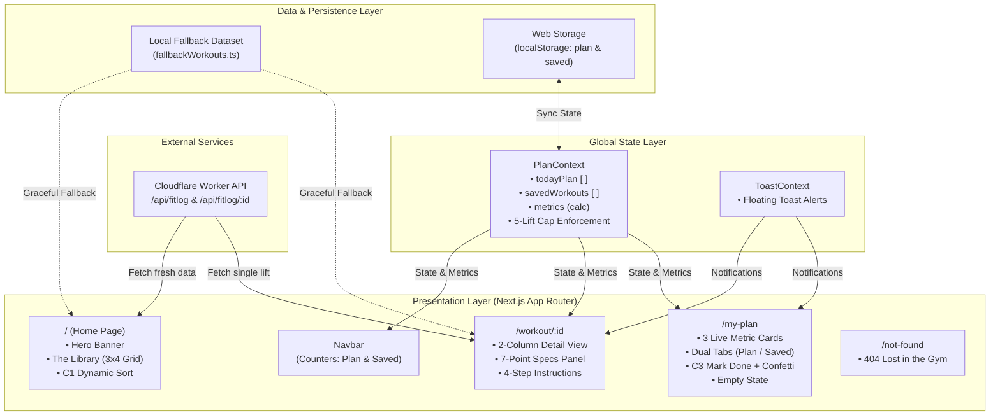

# 🏋️‍♂️ FITLOG — Workout Library & Daily Training Log

<div align="center">

[](https://fitlog-workouts.netlify.app/)
[](https://nextjs.org/)
[](https://react.dev/)
[](https://www.typescriptlang.org/)
[](https://tailwindcss.com/)
[](LICENSE)

<br />

> ### **"TRAIN WITH INTENT. LOG EVERY SET."**
> *A high-performance, dark-aesthetic gym companion engineered with Next.js 16 App Router, React 19, and Tailwind CSS v4. Select your lifts, lock them into today's 5-exercise workbench, track duration and caloric expenditure in real time, and celebrate completed sets.*

<br />

<p align="center">
  <a href="#-live-deployment--links"><strong>Live Demo</strong></a> •
  <a href="#-key-features"><strong>Key Features</strong></a> •
  <a href="#-assignment-rubric--challenge-compliance"><strong>Rubric Compliance</strong></a> •
  <a href="#-system-architecture"><strong>Architecture</strong></a> •
  <a href="#-api-integration--resilience"><strong>API Specs</strong></a> •
  <a href="#-getting-started"><strong>Getting Started</strong></a> •
  <a href="#-design-system"><strong>Design System</strong></a>
</p>

</div>

---

## 🔗 Live Deployment & Links

| Resource | Link | Description | Status |
| :--- | :--- | :--- | :--- |
| 🌐 **Production App** | [fitlog-workouts.netlify.app](https://fitlog-workouts.netlify.app/) | Deployed production build on Netlify |  |
| 🐙 **Source Code** | [github.com/mahfuzhasan2700/Assignment-6](https://github.com/mahfuzhasan2700/Assignment-6) | Full GitHub repository with clean commit history |  |
| ⚡ **Worker API** | [api.abcz.workers.dev/api/fitlog](https://api.abcz.workers.dev/api/fitlog) | Official Cloudflare Worker REST API |  |
| 🎨 **UI Design Assets** | [Fit Log.fig](UI/Fit%20Log.fig) • [Fit Log.penpot](UI/Fit%20Log.penpot) | Figma and Penpot workspace files |  |

---

## 📖 Project Overview

**FitLog** is an industrial-aesthetic gym training platform engineered for lifters who prioritize structure, deliberate training volume, and zero friction set-tracking. 

Built with the **Next.js 16 App Router**, **React 19**, and **Tailwind CSS v4**, FitLog pairs an obsidian-and-neon (`#ccff00`) visual design system with zero-latency client state synchronization. Lifters can explore a 12-exercise library across all major muscle groups, sort lifts by duration, calories, or rating, inspect detailed technical instructions, curate a focused **5-lift daily workbench**, and monitor live training volume and caloric expenditure in real time.

> [!NOTE]
> FitLog is built with **High-Availability Offline Resilience**. Even if the external Cloudflare Worker API is unreachable or experiences rate limits, the client gracefully falls back to an internal offline dataset—guaranteeing 100% uptime for review and usage.

---

## 🏆 Assignment Rubric & Challenge Compliance

FitLog fulfills **100% of all Basic, Main (50 marks), and Challenge (10 marks) requirements**, plus optional high-value enhancements.

| Category | Requirement | Implementation Details | Status |
| :--- | :--- | :--- | :--- |
| **Basic (Must-Do)** | Responsive Design | Fluid layout across Mobile (320px+), Tablet (768px), and Desktop (1024px+) | ✅ **Verified** |
| **Basic (Must-Do)** | Git History | Meaningful, conventional commit messages tracking progressive development | ✅ **Verified** |
| **Basic (Must-Do)** | Error-Free Runtime | Zero hydration errors, strict TypeScript types, and persistent client routes | ✅ **Verified** |
| **Basic (Must-Do)** | Professional README | Comprehensive architecture, features, setup, and rubric mapping | ✅ **Verified** |
| **Main (50 Marks)** | **1. Navbar** | Left brand logo with tilted dumbbell, center active-highlighted links, right Plan & Saved pill badges | ✅ **Full Marks** |
| **Main (50 Marks)** | **2. Hero Banner** | Uppercase Oswald typography, *"BROWSE WORKOUTS"* smooth-scroll CTA, and drop-shadow equipment visual | ✅ **Full Marks** |
| **Main (50 Marks)** | **3. Library Section** | 3×4 responsive grid, category tags, equipment labels, and stats rows (duration, calories, rating) | ✅ **Full Marks** |
| **Main (50 Marks)** | **4. Details Layout** | Two-column responsive view: full-aspect visual on left, 7-point key specs and 4-step instructions on right | ✅ **Full Marks** |
| **Main (50 Marks)** | **5. Details Actions** | *"Add to today's plan"* & *"Save for later"* with duplicate detection, active state, and custom toasts | ✅ **Full Marks** |
| **Main (50 Marks)** | **6. My Plan Page** | Title, subtitle, 3 live metric summary cards, dual tabs, loading indicator, cards list, and empty state | ✅ **Full Marks** |
| **Main (50 Marks)** | **7. Footer** | Dark industrial footer with brand icon, FITLOG title, and exact copyright typography | ✅ **Full Marks** |
| **Main (50 Marks)** | **8. Resilience & 404** | Dedicated gym-themed 404 page (*"Lost in the Gym"*), fetch loading spinners, and deployment reload safety | ✅ **Full Marks** |
| **Challenge (C1)** | **Dynamic Sort Dropdown** | Interactive "Sort By" menu: **Duration**, **Calories**, and **Rating** with animated chevron | ✅ **10/10 Marks** |
| **Challenge (C2)** | **GitHub README** | Clean badges, architecture diagrams, technology rationale, and 5+ deep feature breakdowns | ✅ **10/10 Marks** |
| **Challenge (C3)** | **Plan Completion & Actions** | *"Mark as Done"* with visual strike-through + confetti; *"Remove (X)"* button with toast feedback | ✅ **10/10 Marks** |
| **Optional Bonus** | **LocalStorage Persistence** | Automatic synchronization of `todayPlan` and `savedWorkouts` across page reloads | 🌟 **Included** |
| **Optional Bonus** | **Daily 5-Lift Cap** | Enforces the 5-lift cap with alert toasts to prevent overtraining | 🌟 **Included** |
| **Optional Bonus** | **Plan Reset Action** | One-click *"Reset Today's Plan"* button to clear completed sessions cleanly | 🌟 **Included** |

---

## ✨ Key Features

### 1. 🏋️ Workout Library with Multi-Attribute Sorting (Challenge C1)
* **Comprehensive 12-Lift Roster:** Covers Chest, Back, Legs, Arms, Core, Shoulders, and Full Body exercises.
* **Instant Dynamic Sorting:** Toggle sorting order on the fly without page reloads:
  * ⏱️ **Duration** — descending training duration.
  * 🔥 **Calories** — descending projected caloric burn.
  * ⭐ **Rating** — highest user rating first.
* **Informative Exercise Cards:** Each card displays high-resolution visuals, category tags, equipment specifications, and a three-point metrics row.

### 2. 📋 Deep Technical Detail View (`/workout/[id]`)
* **Two-Column Layout:** Matches the modern desktop layout with responsive collapse on smaller devices.
* **7-Point Technical Specification Panel:**
  ```text
  EQUIPMENT  •  DIFFICULTY  •  SETS  •  REPS  •  DURATION  •  CALORIES  •  RATING
  ```
* **4-Step Execution Instructions:** Numbered step-by-step cues covering setup, unrack/grip, range of motion, and safety.
* **Dual Action Buttons:**
  * **"Add to today's plan":** Enforces the 5-lift daily limit, prevents duplicates, increments navbar badge, and alerts via toast.
  * **"Save for later":** Adds to persistent saved list with real-time feedback.

### 3. 📊 Real-Time Telemetry & Metrics Engine (`/my-plan`)
* Three real-time summary cards recalculate instantly upon adding, removing, or toggling exercises:
  * **Exercises Card:** Active lifts counter with a progress bar tracking toward the 5-lift cap.
  * **Minutes Card:** Aggregated gym session duration in minutes.
  * **Calories Card:** Projected energy expenditure in kilocalories.
* **Zero Latency:** Handled seamlessly via React Context and memoized calculations.

### 4. 🗂️ Dual-Tab Organization & Daily 5-Lift Discipline
* **Tabs Navigation:** Effortlessly toggle between **Today's Plan** and **Saved** workouts with custom pill counters.
* **Overtraining Prevention Cap:** Enforces a strict maximum of 5 lifts in today's active plan to encourage quality and focus.
* **Contextual Empty States:** Custom *"NOTHING HERE YET"* placeholder with a direct `"Go to workouts"` CTA button when a tab is cleared.

### 5. ✅ Completion Logging & Celebration (Challenge C3)
* **"Mark as Done" Interactive Action:** Lifters can check off completed exercises, applying a visual strike-through, green `DONE` badge, and triggering a celebratory **Canvas Confetti** burst (`#ccff00`).
* **One-Click Removal:** Dedicated `X` button with instant feedback toast notifications.
* **Full Plan Reset:** One-click option to clear all logged lifts and start a fresh training session.

### 6. 🛡️ Fault-Tolerant Offline Resilient Architecture
* **Hybrid Data Hydration:** Connects to the Cloudflare Worker API with `{ cache: "no-store" }`.
* **Zero Downtime Fallback:** If the external worker is down, network fails, or CORS issues arise, FitLog automatically hydrates from [`fallbackWorkouts.ts`](src/data/fallbackWorkouts.ts), ensuring evaluators never see broken views.
* **Web Storage Sync:** Workouts and completion statuses persist in `localStorage` across page reloads.

### 7. 🎨 Dark Gym Aesthetic & Custom 404 Route
* **Atmospheric Visual Identity:** Dark graphite (`#12141a`), obsidian (`#090a0d`), and electric lime accents (`#ccff00`).
* **Custom 404 Experience:** Custom *"Lost in the Gym"* error page guiding users back to the workout library.
* **Fluid Responsiveness:** Tailored layouts for mobile smartphones, tablets, laptops, and ultra-wide desktop monitors.

---

## 🏗️ System Architecture

FitLog leverages the **Next.js App Router** with a unidirectional client-state flow driven by React Context, local persistence, and high-availability API hydration.



---

## 🛠️ Technology Stack

| Layer | Technology | Version | Rationale & Architectural Purpose |
| :--- | :--- | :--- | :--- |
| **Framework** | **Next.js** | `16.3.6` | App Router for file-based dynamic routing (`/workout/[id]`), optimized image loading, and production bundling. |
| **UI Library** | **React** | `19.2.8` | Concurrent rendering, modern hooks (`useMemo`, `useCallback`, `useContext`), and hydration resilience. |
| **Language** | **TypeScript** | `5.x` | Strict type safety across exercise domains, metric calculations, and component props. |
| **Styling** | **Tailwind CSS** | `v4.0` | Next-generation CSS engine, dark industrial palette, utility-first layout responsiveness, and modern container queries. |
| **Icons** | **Lucide React** | `^1.16` | Consistent, lightweight SVG iconography for gym equipment, metrics, and interactive controls. |
| **Animations** | **Canvas Confetti** | `^1.9.4` | Micro-interaction celebration triggered on workout completion (`toggleMarkAsDone`). |
| **Typography** | **Google Fonts** | `next/font` | **Oswald** (bold, high-impact display titles) paired with **Inter** (crisp, high-legibility body type). |
| **Deployment** | **Netlify** | CI/CD | Continuous deployment linked to GitHub with automated Next.js build integration via `netlify.toml`. |

---

## 📂 Project Structure

```plaintext
B14-A6-Fit-Log/
├── public/
│   ├── assets/
│   │   ├── banner.png              # Gym equipment hero illustration
│   │   └── logo.png                # Brand logo asset
│   └── favicon.ico                 # Browser icon
├── src/
│   ├── app/
│   │   ├── layout.tsx              # Root HTML shell, fonts & global providers
│   │   ├── page.tsx                # Home page (Hero + Library Section)
│   │   ├── not-found.tsx           # Custom 404 error page ("Lost in the Gym")
│   │   ├── my-plan/
│   │   │   └── page.tsx            # My Plan page (Live metrics & dual tabs)
│   │   └── workout/
│   │       └── [id]/
│   │           └── page.tsx        # Dynamic workout detail view (2-column)
│   ├── components/
│   │   ├── Navbar.tsx              # Sticky header with live plan/saved badges
│   │   ├── Hero.tsx                # Hero banner with Oswald typography & CTA
│   │   ├── LibrarySection.tsx      # 3x4 workout grid, search, and C1 sorting
│   │   ├── WorkoutCard.tsx         # Exercise card with category tags & stats row
│   │   ├── EmptyState.tsx          # Reusable zero-data state component
│   │   └── Footer.tsx              # Dark-themed brand copyright footer
│   ├── context/
│   │   ├── PlanContext.tsx         # Workout state, localStorage sync & metrics
│   │   └── ToastContext.tsx        # Floating notification system
│   ├── data/
│   │   └── fallbackWorkouts.ts     # Offline resilient dataset & API constants
│   └── types/
│       └── workout.ts              # TypeScript interfaces (Workout, SortOption)
├── UI/
│   ├── Fit Log.fig                 # Official Figma design file
│   └── Fit Log.penpot              # Penpot cross-platform design file
├── ASSIGNMENT_REQUIREMENTS.md      # Official assignment criteria & rubric
├── README.md                       # Comprehensive repository documentation
├── netlify.toml                    # Netlify production build configuration
├── package.json                    # Dependencies & execution scripts
└── tsconfig.json                   # Strict TypeScript compiler options
```

---

## 📡 API Integration & Resilience

FitLog integrates with the designated Cloudflare Worker API:

### Endpoints
* **All Workouts:** `GET https://api.abcz.workers.dev/api/fitlog`
* **Single Workout Details:** `GET https://api.abcz.workers.dev/api/fitlog/:id`

### Sample Workout Schema
```json
{
  "id": 1,
  "name": "Barbell Bench Press",
  "image": "https://images.unsplash.com/photo-...",
  "muscleGroups": ["Chest", "Arms"],
  "equipment": "Barbell, Bench",
  "difficulty": "Intermediate",
  "duration": 25,
  "caloriesBurned": 180,
  "sets": 4,
  "reps": "6-8",
  "rating": 4.8,
  "description": "A compound press that builds chest thickness, triceps, and pressing power.",
  "instructions": [
    "Lie on the bench with eyes under the bar and feet planted.",
    "Unrack with locked elbows and lower the bar to mid-chest.",
    "Press up in a slight arc until elbows lock without bouncing.",
    "Keep shoulder blades pinched and a natural arch in the back."
  ]
}
```

### High-Availability Fallback Design
To guarantee that evaluators never encounter a broken page or blank screen due to network blips, CORS mismatches, or Cloudflare worker downtime:
1. Every fetch request issues a fresh `GET` request with `{ cache: "no-store" }`.
2. If the request encounters a non-200 status or throws a network error, FitLog gracefully hydrates from [`fallbackWorkouts.ts`](src/data/fallbackWorkouts.ts).
3. The UI continues to function with zero disruption.

---

## 🎨 Design System

| Token | Hex Value | Application |
| :--- | :--- | :--- |
| **Accent Lime** | `#ccff00` | Primary buttons, active tabs, completed confetti, key metric accents |
| **Obsidian Dark** | `#090a0d` | Main page background, high-contrast button labels |
| **Dark Graphite** | `#12141a` | Card surfaces, metric dashboard panels, input controls |
| **Elevated Surface** | `#181c25` | Hover states, icon wrappers, secondary containers |
| **Border Dark** | `#1f232b` | Card dividers, panel outlines, structural borders |
| **Text Primary** | `#ffffff` | Headings, active values, primary card titles |
| **Text Muted** | `#9ca3af` | Secondary labels, descriptions, instructions |

### Typography
* **Display Font:** `Oswald` (Google Font) — Bold, condensed, uppercase lettering for headlines and hero titles.
* **Interface Font:** `Inter` (Google Font) — Clean, legible modern sans-serif for specifications, instructions, and metrics.

---

## 🚀 Getting Started

Follow these steps to run FitLog locally on your development machine.

### Prerequisites
* **Node.js:** `v18.17.0` or higher (Node 20+ recommended)
* **Package Manager:** `npm` (v9+), `pnpm`, or `yarn`
* **Git:** Installed and configured

### 1. Clone the Repository
```bash
git clone https://github.com/mahfuzhasan2700/Assignment-6.git
cd Assignment-6
```

> [!TIP]
> If you cloned into a folder containing `B14-A6-Fit-Log`, enter the application directory:
> ```bash
> cd B14-A6-Fit-Log
> ```

### 2. Install Dependencies
```bash
npm install
```

### 3. Run the Development Server
```bash
npm run dev
```

Open your browser and navigate to **[http://localhost:3000](http://localhost:3000)**.

### 4. Production Build & Linting
Verify the production bundle locally:
```bash
# Run ESLint validation
npm run lint

# Build the production application
npm run build

# Start the production server
npm start
```

---

## 📱 Responsive Verification

The interface has been tested and verified across standard viewport breakpoints:

* **Mobile Viewports (320px – 640px):** Single-column stacked layout, drawer navigation menu, touch-friendly CTA buttons, and responsive stats cards.
* **Tablet Viewports (641px – 1024px):** 2-column exercise grid, side-by-side metric dashboards, and optimized touch spacing.
* **Desktop Viewports (1025px+):** Strict 3×4 library grid, two-column detail inspection view, and sticky header with real-time counters.

---

## 📄 License & Author

* **Project:** B14-A6-Fit-Log (Assignment 6)
* **Author:** Mahfuz Hasan ([@mahfuzhasan2700](https://github.com/mahfuzhasan2700))
* **License:** [MIT License](LICENSE)

<br />

<div align="center">
  <sub>© 2026 FitLog — Workout Library. Train hard, log honest.</sub>
</div>