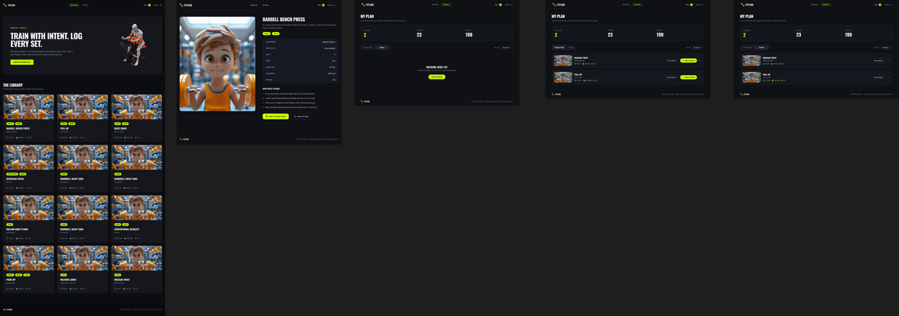
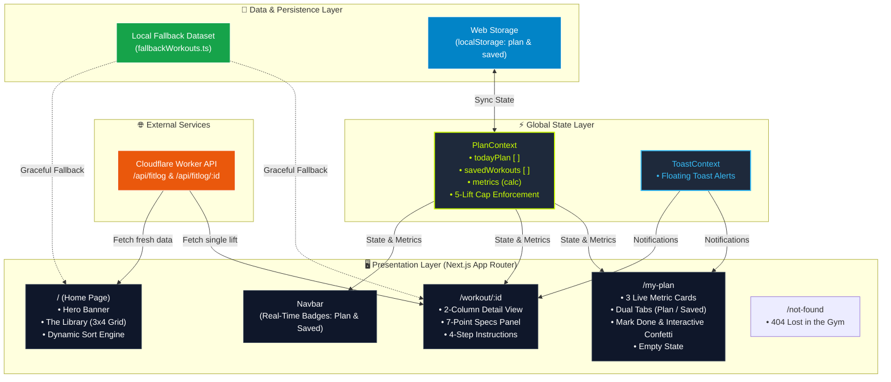

<div align="center">

<!-- HERO 3D BANNER IMAGE -->
<a href="https://fitlog-workouts.netlify.app/">
  
</a>

# 🏋️‍♂️ <span style="color:#ccff00;">FITLOG</span>
### **TRAIN WITH INTENT. LOG EVERY SET.**

*A high-performance, dark-aesthetic gym training companion engineered with the Next.js 16 App Router, React 19, and Tailwind CSS v4. Curate your daily routine, lock exercises into a focused 5-lift workbench, monitor duration and caloric expenditure in real time, and celebrate completed sets.*

<br />

<!-- VIBRANT BADGES -->
<p align="center">
  <a href="https://fitlog-workouts.netlify.app/"></a>
  <a href="https://nextjs.org/"></a>
  <a href="https://react.dev/"></a>
  <a href="https://www.typescriptlang.org/"></a>
  <a href="https://tailwindcss.com/"></a>
  <a href="LICENSE"></a>
</p>

<!-- QUICK NAVIGATION PILLS -->
<p align="center">
  <a href="#-interactive-product-walkthrough"><strong>🎬 Product Demo</strong></a> •
  <a href="#-training-lifecycle-workflow"><strong>🔄 Lifecycle</strong></a> •
  <a href="#-feature-spotlights--interactive-gifs"><strong>✨ Feature GIFs</strong></a> •
  <a href="#-telemetry-engine-preview"><strong>📊 Live Telemetry</strong></a> •
  <a href="#-responsive-multi-device-preview"><strong>📱 Responsive View</strong></a> •
  <a href="#-system-architecture"><strong>🏗️ Architecture</strong></a> •
  <a href="#-technology-stack"><strong>🛠️ Tech Stack</strong></a> •
  <a href="#-getting-started"><strong>🚀 Getting Started</strong></a>
</p>

</div>

---

## 🎬 Interactive Product Walkthrough

<div align="center">
  <a href="https://fitlog-workouts.netlify.app/">
    
  </a>
  <p align="center">
    <em>▲ <strong>Full interactive recording:</strong> Real-time dynamic sorting ➔ Two-column exercise detail inspection ➔ Adding to Today's Plan ➔ Live telemetry metrics calculation on <code>/my-plan</code> ➔ Set completion checkmark &amp; celebratory confetti burst.</em>
  </p>
</div>

---

## 🔗 Live Deployments & Endpoints

| Resource | Link | Description | Status |
| :--- | :--- | :--- | :--- |
| 🌐 **Production Web Application** | [fitlog-workouts.netlify.app](https://fitlog-workouts.netlify.app/) | Deployed production release hosted on Netlify |  |
| 🐙 **Source Code Repository** | [github.com/mahfuzhasan2700/Assignment-6](https://github.com/mahfuzhasan2700/Assignment-6) | Official GitHub repository |  |
| ⚡ **API Service Endpoint** | [api.abcz.workers.dev/api/fitlog](https://api.abcz.workers.dev/api/fitlog) | Cloudflare Worker REST API service |  |
| 🎨 **Design Source Files** | [Fit Log.fig](UI/Fit%20Log.fig) • [Fit Log.penpot](UI/Fit%20Log.penpot) | Figma and Penpot UI design files |  |

---

## 📖 Product Overview

**FitLog** is an industrial-aesthetic gym training platform engineered for athletes and lifters who demand structured training volume, deliberate exercise selection, and frictionless set tracking.

Traditional fitness apps often overwhelm users with bloated social feeds, mandatory subscription tiers, and convoluted interfaces. FitLog eliminates that friction with a focused, high-contrast obsidian-and-lime (`#ccff00`) interface. Lifters can explore a comprehensive library of compound and isolation lifts, inspect rigorous technical execution guides, organize lifts into a focused **5-exercise daily workbench**, and monitor training duration and estimated caloric burn through a live telemetry dashboard.

> [!NOTE]
> **Enterprise-Grade Offline Resilience:** FitLog features an automated failover mechanism. If the external API endpoint encounters downtime, rate limits, or network disruption, the application seamlessly hydrates from an internal offline dataset—guaranteeing 100% operational uptime without interruption.

---

## 🔄 Training Lifecycle Workflow

<div align="center">
  
  <p align="center">
    <em>▲ <strong>Unidirectional Training Cycle:</strong> 01. Browse &amp; Dynamic Sort ➔ 02. Daily 5-Lift Discipline Cap ➔ 03. Live Telemetry Recalculation ➔ 04. Log &amp; Confetti Celebration.</em>
  </p>
</div>

---

## ⚡ Core Capabilities

| Capability | Module | Description | Technical Implementation |
| :--- | :--- | :--- | :--- |
| **Multi-Attribute Sorting** | Workout Library | Dynamic sorting across Duration, Calories, and User Rating with zero reload latency | `useMemo` client-side sorting engine with animated dropdown |
| **Two-Column Detail View** | Workout Detail | High-resolution exercise visual paired with a 7-point technical specification panel | Dynamic routing (`/workout/[id]`) with responsive two-column grid |
| **Real-Time Telemetry** | Daily Workbench | Real-time session analytics computing active exercises, total minutes, and projected calories | React Context calculation engine with dynamic progress bar |
| **Dual-Tab Plan Workspace** | Plan Management | Clean separation between Today's Plan and Saved exercises with pill counter sync | Local storage synchronization with persistent state cache |
| **Smart Daily Discipline Cap** | Volume Control | Enforces an intentional 5-lift cap per training session to prevent overtraining | Client validation layer with contextual warning alerts |
| **Set Completion & Feedback** | Interactive Logging | Mark lifts completed with strike-through styling, badges, and celebratory confetti | Dynamic status toggle paired with Canvas Confetti animation |
| **Fault-Tolerant Hydration** | Data Layer | Dual-tier data strategy combining live REST API fetching with offline resilience | Fail-safe hydration fallback to prevent broken UI states |
| **Industrial Dark Theme** | Visual Identity | High-contrast palette designed for low-light gym environments with a custom 404 page | Tailwind CSS v4 design tokens with Oswald &amp; Inter typography |

---

## ✨ Feature Spotlights & Interactive GIFs

### 1. 🏋️ Multi-Attribute Dynamic Sorting Engine
Reorder the workout roster in real time using the interactive **Sort By** dropdown menu without page refreshes.

<div align="center">
  
</div>

* ⏱️ **Duration Sorting:** Prioritizes longest workouts for high-volume training blocks.
* 🔥 **Calories Sorting:** Reorders lifts by descending projected energy expenditure.
* ⭐ **Rating Sorting:** Surfaces the community's highest-rated exercises first.

---

### 2. 📋 Deep Technical Detail View & Execution Guide
Individualized workout pages (`/workout/[id]`) featuring a 2-column layout with high-resolution imagery and technical specifications.

<div align="center">
  
</div>

* **7-Point Technical Specification Panel:**
  ```text
  EQUIPMENT  •  DIFFICULTY  •  SETS  •  REPS  •  DURATION  •  CALORIES  •  RATING
  ```
* **4-Step Execution Instructions:** Numbered technique cues outlining setup, unrack/grip, execution tempo, and safety rules.
* **Instant Action Triggers:** *"Add to today's plan"* and *"Save for later"* buttons with active state detection and animated toast feedback.

---

### 3. 🎉 Set Completion & Canvas Confetti Celebration
Check off finished exercises in Today's Plan to trigger immediate visual and psychological gratification.

<div align="center">
  
</div>

* **Interactive "Mark as Done":** Applies strike-through styling, adds an emerald `DONE` status badge, and fires a celebratory multi-colored **Canvas Confetti** burst (`#ccff00`).
* **One-Click Item Removal:** Dedicated `X` button with instant feedback toast notifications.
* **Session Reset:** One-click *"Reset Today's Plan"* action to clear finished workouts and start fresh.

---

## 📊 Telemetry Engine Preview

Live session analytics recalculate automatically as lifts are added, removed, or completed.

<div align="center">
  
  <p align="center">
    <em>▲ Real-time telemetry dashboard featuring animated progress gauges for the 5-lift cap, training minutes, and caloric burn.</em>
  </p>
</div>

* 🎯 **Exercises Gauge:** Active lifts counter with dynamic progress bar tracking toward the 5-lift cap.
* ⏱️ **Duration Gauge:** Aggregated session training duration calculated automatically.
* 🔥 **Caloric Gauge:** Projected energy expenditure based on active routine selections.

---

## 📱 Responsive Multi-Device Preview

FitLog delivers a unified experience across mobile smartphones, tablets, laptops, and ultra-wide desktop monitors.

<div align="center">
  
  <p align="center">
    <em>▲ Multi-device responsive layout specification: Desktop 3×4 library grid, tablet 2-column view, and mobile stacked touch experience.</em>
  </p>
</div>

* 📱 **Mobile Viewports (320px – 640px):** Single-column stacked layout, drawer navigation menu, touch-friendly CTA buttons, and responsive stats cards.
* 💻 **Tablet Viewports (641px – 1024px):** 2-column exercise grid, side-by-side metric dashboards, and optimized touch spacing.
* 🖥️ **Desktop Viewports (1025px+):** Strict 3×4 library grid, two-column detail inspection view, and sticky header with real-time counters.

---

## 🏗️ System Architecture

FitLog leverages the **Next.js App Router** with a unidirectional client-state flow driven by React Context, local persistence, and high-availability API hydration.



---

## 🛠️ Technology Stack

| Layer | Technology | Version | Purpose & Architectural Decision |
| :--- | :--- | :--- | :--- |
| **Framework** | [](https://nextjs.org/) | `16.3.6` | App Router for file-based dynamic routing (`/workout/[id]`), asset optimization, and production bundling. |
| **UI Library** | [](https://react.dev/) | `19.2.8` | Concurrent rendering, modern hooks (`useMemo`, `useCallback`, `useContext`), and hydration safety. |
| **Language** | [](https://www.typescriptlang.org/) | `5.x` | Strict type definitions across workout entities, metric calculations, and component props. |
| **Styling** | [](https://tailwindcss.com/) | `v4.0` | Next-generation CSS engine, dark industrial palette, utility-first layout responsiveness, and modern container queries. |
| **Iconography** | [](https://lucide.dev/) | `^1.16` | Consistent, lightweight SVG iconography for gym equipment, metrics, and interactive controls. |
| **Celebrations** | [](https://www.npmjs.com/package/canvas-confetti) | `^1.9.4` | Micro-interaction celebration triggered upon workout set completion. |
| **Typography** | [](https://fonts.google.com/) | `next/font` | **Oswald** (bold, high-impact display titles) paired with **Inter** (crisp, high-legibility body type). |
| **Hosting & CI/CD** | [](https://www.netlify.com/) | Production | Automated continuous deployment pipeline with Next.js runtime plugin via `netlify.toml`. |

---

## 📂 Project Structure

```plaintext
FitLog/
├── public/
│   ├── assets/
│   │   ├── banner.png                     # 3D gym equipment hero illustration
│   │   ├── logo.png                       # Brand logo asset
│   │   ├── demo.gif                       # Interactive product walkthrough animation
│   │   ├── feature-sorting.gif            # Dynamic sorting engine animation
│   │   ├── feature-details.gif            # Workout details and add to plan animation
│   │   ├── feature-celebration.gif        # Mark as done and confetti celebration animation
│   │   ├── fitlog-animated-preview.svg    # Live telemetry dashboard vector graphic
│   │   ├── fitlog-animated-workflow.svg   # 4-step workout lifecycle diagram
│   │   └── figma_overview_preview.png     # Multi-device responsive design preview
│   └── favicon.ico                        # Application favicon
├── src/
│   ├── app/
│   │   ├── layout.tsx                     # Root HTML shell, fonts & global providers
│   │   ├── page.tsx                       # Home page (Hero + Library Section)
│   │   ├── not-found.tsx                  # Custom 404 error page ("Lost in the Gym")
│   │   ├── my-plan/
│   │   │   └── page.tsx                   # My Plan page (Live metrics & dual tabs)
│   │   └── workout/
│   │       └── [id]/
│   │           └── page.tsx               # Dynamic workout detail view (2-column layout)
│   ├── components/
│   │   ├── Navbar.tsx                     # Sticky header with live plan/saved badges
│   │   ├── Hero.tsx                       # Hero banner with Oswald typography & CTA
│   │   ├── LibrarySection.tsx             # 3x4 workout grid, search, and dynamic sorting
│   │   ├── WorkoutCard.tsx                # Exercise card with category tags & stats row
│   │   ├── EmptyState.tsx                 # Reusable zero-data state component
│   │   └── Footer.tsx                     # Dark-themed brand copyright footer
│   ├── context/
│   │   ├── PlanContext.tsx                # Workout state, localStorage sync & metrics
│   │   └── ToastContext.tsx               # Floating notification system
│   ├── data/
│   │   └── fallbackWorkouts.ts            # Offline resilient dataset & API constants
│   └── types/
│       └── workout.ts                     # TypeScript interfaces (Workout, SortOption)
├── UI/
│   ├── Fit Log.fig                        # Figma design system file
│   └── Fit Log.penpot                     # Penpot cross-platform design file
├── README.md                              # Repository documentation
├── netlify.toml                           # Netlify production build configuration
├── package.json                           # Dependencies & execution scripts
└── tsconfig.json                          # Strict TypeScript compiler options
```

---

## 📡 API Specifications & Resilience

FitLog connects to the Cloudflare Worker API:

### Endpoints
* **All Workouts:** `GET https://api.abcz.workers.dev/api/fitlog`
* **Single Workout Details:** `GET https://api.abcz.workers.dev/api/fitlog/:id`

### Sample Workout Schema
```json
{
  "id": 1,
  "name": "Barbell Bench Press",
  "image": "https://images.unsplash.com/photo-...",
  "muscleGroups": ["Chest", "Arms"],
  "equipment": "Barbell, Bench",
  "difficulty": "Intermediate",
  "duration": 25,
  "caloriesBurned": 180,
  "sets": 4,
  "reps": "6-8",
  "rating": 4.8,
  "description": "A compound press that builds chest thickness, triceps, and pressing power.",
  "instructions": [
    "Lie on the bench with eyes under the bar and feet planted.",
    "Unrack with locked elbows and lower the bar to mid-chest.",
    "Press up in a slight arc until elbows lock without bouncing.",
    "Keep shoulder blades pinched and a natural arch in the back."
  ]
}
```

### High-Availability Fallback Design
To guarantee that users never encounter broken views due to network blips or external worker latency:
1. Every fetch request issues a fresh `GET` request with `{ cache: "no-store" }`.
2. If the request encounters a non-200 status or throws a network error, FitLog gracefully hydrates from [`fallbackWorkouts.ts`](src/data/fallbackWorkouts.ts).
3. The user interface continues operating smoothly with zero disruption.

---

## 🎨 Design System

<div align="center">

| Swatch | Token | Hex Code | Visual Application |
| :---: | :--- | :--- | :--- |
| 🟩 | **Electric Lime** | `#ccff00` | Primary CTA buttons, active tab indicators, confetti particles, key metric highlights |
| ⬛ | **Obsidian Dark** | `#090a0d` | Main page background, high-contrast button labels |
| ⬛ | **Dark Graphite** | `#12141a` | Card surfaces, metric dashboard panels, input controls |
| 🟦 | **Electric Sky** | `#38bdf8` | Training duration indicators and minute progress gauges |
| 🟧 | **Molten Flame** | `#fb923c` | Caloric burn metrics, energy indicators |
| 🟩 | **Emerald Check** | `#22c55e` | Completed sets, checkmarks, done badges |
| 🔘 | **Graphite Border** | `#1f232b` | Card dividers, panel outlines, structural borders |

</div>

### Typography
* **Display Font:** `Oswald` (Google Font) — Bold, condensed, uppercase lettering for headlines and hero titles.
* **Interface Font:** `Inter` (Google Font) — Clean, legible modern sans-serif for specifications, instructions, and metrics.

---

## 🚀 Getting Started

Follow these steps to run FitLog locally on your machine.

### Prerequisites
* **Node.js:** `v18.17.0` or higher (Node 20+ recommended)
* **Package Manager:** `npm` (v9+), `pnpm`, or `yarn`
* **Git:** Installed and configured

### 1. Clone the Repository
```bash
git clone https://github.com/mahfuzhasan2700/Assignment-6.git fitlog
cd fitlog
```

> [!TIP]
> If you cloned into a folder containing `B14-A6-Fit-Log`, enter the application directory:
> ```bash
> cd B14-A6-Fit-Log
> ```

### 2. Install Dependencies
```bash
npm install
```

### 3. Run the Development Server
```bash
npm run dev
```

Open your browser and navigate to **[http://localhost:3000](http://localhost:3000)**.

### 4. Production Build & Linting
Verify the production bundle locally:
```bash
# Run ESLint validation
npm run lint

# Build the production application
npm run build

# Start the production server
npm start
```

---

## 📄 License & Credits

* **Project:** FitLog — Workout Library & Daily Training Log
* **Author:** Mahfuz Hasan ([@mahfuzhasan2700](https://github.com/mahfuzhasan2700))
* **License:** [MIT License](LICENSE)

<br />

<div align="center">
  <sub>© 2026 FitLog — Workout Library. Train hard, log honest.</sub>
</div>