<div align="center">


<picture>
  <source media="(prefers-color-scheme: dark)" srcset="assets/banner.png" />
  <source media="(prefers-color-scheme: light)" srcset="assets/banner.png" />
  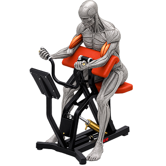
</picture>



<br />

[](https://fitlog-workouts.netlify.app/)
[](https://github.com/mahfuzhasan2700/Assignment-6)

[](https://nextjs.org/)
[](https://react.dev/)
[](https://www.typescriptlang.org/)
[](https://tailwindcss.com/)
[](https://fitlog-workouts.netlify.app/)

<br />

<p align="center">
  <a href="#-demo"><strong>Demo</strong></a> &nbsp;•&nbsp;
  <a href="#-links"><strong>Links</strong></a> &nbsp;•&nbsp;
  <a href="#-overview"><strong>Overview</strong></a> &nbsp;•&nbsp;
  <a href="#-the-training-loop"><strong>Lifecycle</strong></a> &nbsp;•&nbsp;
  <a href="#-key-features"><strong>Features</strong></a> &nbsp;•&nbsp;
  <a href="#-live-telemetry"><strong>Telemetry</strong></a> &nbsp;•&nbsp;
  <a href="#-architecture"><strong>Architecture</strong></a> &nbsp;•&nbsp;
  <a href="#-tech-stack"><strong>Tech Stack</strong></a> &nbsp;•&nbsp;
  <a href="#-project-structure"><strong>Structure</strong></a> &nbsp;•&nbsp;
  <a href="#-api-reference"><strong>API</strong></a> &nbsp;•&nbsp;
  <a href="#-getting-started"><strong>Getting Started</strong></a>
</p>


</div>

## 🎬 Demo

<div align="center">

<a href="https://fitlog-workouts.netlify.app/">
  <picture>
    <source srcset="assets/demo.webp" type="image/webp" />
    
  </picture>
</a>

<p><em>Sort the library → inspect a lift → lock it into today's plan → metrics recalculate → mark it done and the confetti fires.<br />Click the animation to open the live build.</em></p>


</div>

## 🔗 Links

| Resource | Link | Description |
| :--- | :--- | :--- |
| **Live application** | [fitlog-workouts.netlify.app](https://fitlog-workouts.netlify.app/) | Production deployment hosted on Netlify |
| **Source repository** | [github.com/mahfuzhasan2700/Assignment-6](https://github.com/mahfuzhasan2700/Assignment-6) | GitHub repository with full commit history |
| **Worker REST API** | [api.abcz.workers.dev/api/fitlog](https://api.abcz.workers.dev/api/fitlog) | Cloudflare Worker REST API endpoint |
| **Design sources** | [Fit Log.fig](UI/Fit%20Log.fig) • [Fit Log.penpot](UI/Fit%20Log.penpot) | Figma and Penpot interface design systems |

<div align="center"></div>

## 📖 Overview

FitLog is a dark, no-nonsense gym companion. Browse a library of twelve lifts covering every major muscle group, open any one of them for the full technical breakdown, then lock it into today's plan and watch the minutes and calories add up as you work.

The app is built around one deliberate constraint: **today's plan holds five lifts and not a sixth**. Most fitness apps let you queue twenty exercises you will never finish. FitLog caps the session, shows what that cap costs you in time and calories, and lets you check each lift off as it is done.

> [!NOTE]
> **The app never shows a broken screen.** Every request runs with `{ cache: "no-store" }` for fresh data. If the API returns a non-OK status or throws, FitLog hydrates from a bundled twelve-lift dataset instead, so the library, the detail pages and the plan all keep working during an outage.

<div align="center"></div>

## 🔄 The Training Loop

<div align="center">


<br />


</div>

## ✨ Key Features

### 1. Workout library with multi-attribute sorting

<table>
<tr>
<td width="55%" valign="top">

Twelve foundational lifts spanning Chest, Back, Legs, Arms, Core, Shoulders and Full Body, rendered as a 3×4 grid on desktop.

The **Sort By** dropdown reorders the grid instantly through a `useMemo` selector — no refetch, no route change:

- ⏱️ **Duration** — longest sessions first
- 🔥 **Calories** — highest burn first
- ⭐ **Rating** — highest rated first

Each card carries the illustration, muscle-group tag pills, the equipment line and a three-stat row.

</td>
<td width="45%" valign="top">

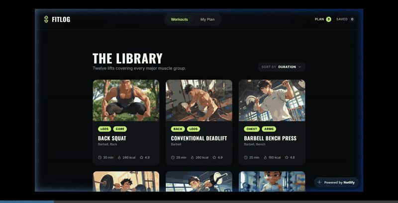

</td>
</tr>
</table>

### 2. Two-column detail view at `/workout/[id]`

<table>
<tr>
<td width="45%" valign="top">

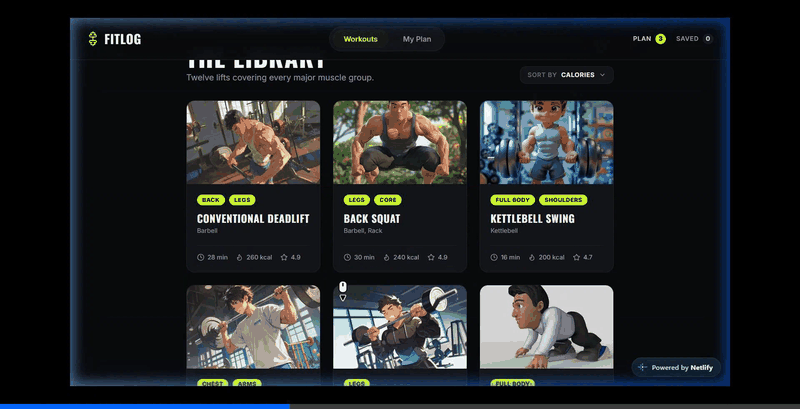

</td>
<td width="55%" valign="top">

A full-height exercise visual on the left, the technical breakdown on the right.

**Seven-point specification panel:**

```text
EQUIPMENT · DIFFICULTY · SETS · REPS
DURATION  · CALORIES   · RATING
```

**Four numbered instruction steps** covering setup, unrack and grip, execution range of motion, and the safety cue.

Two actions close the loop: **Add to today's plan** (duplicate-checked, cap-enforced) and **Save for later**. Both fire a toast and update the navbar badges.

</td>
</tr>
</table>

### 3. Live telemetry on `/my-plan`

<div align="center">


</div>

Three summary cards derive straight from plan state through a memoized selector, so they recompute the moment anything is added, removed or toggled:

- **Exercises** — active lift count, with a progress bar tracking the five-lift ceiling
- **Minutes** — summed `duration` across today's plan
- **Calories** — summed `caloriesBurned` across today's plan

### 4. Dual-tab workspace and the five-lift cap

<div align="center">


</div>

- **Today's Plan** and **Saved** tabs, each with its own live count pill mirrored in the navbar.
- The sixth add is refused with a `LIMIT REACHED` warning toast instead of silently growing the list.
- Adding something already in a list raises an "already added" notice rather than a duplicate row.
- Empty lists show **NOTHING HERE YET** with a **Go to workouts** button back to the library.

### 5. Completion logging with confetti

<table>
<tr>
<td width="55%" valign="top">

**Mark as Done** flips the lift to completed, applies strike-through styling, swaps the label to **Completed**, and fires a 40-particle `canvas-confetti` burst in lime, white and grey. Toggling it back marks the lift incomplete again.

**View Details** jumps to the lift's detail page. The **✕** button removes it with a toast. **Reset Today's Plan** clears the whole session in one click.

</td>
<td width="45%" valign="top">

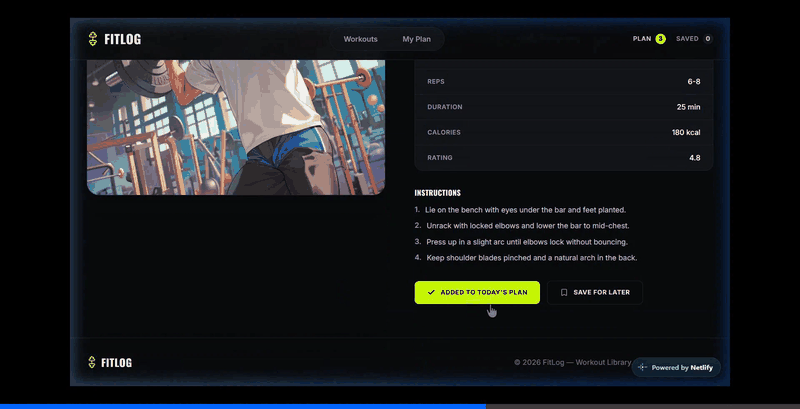

</td>
</tr>
</table>

### 6. Fault-tolerant data layer and persistence

- Remote fetch first with `{ cache: "no-store" }`; automatic failover to [`fallbackWorkouts.ts`](src/data/fallbackWorkouts.ts) on a non-OK status or a thrown request.
- Today's plan, the saved list and every completion flag sync to `localStorage`, so a reload restores the session exactly.
- Loading states render while data is in flight: *"Loading workouts from library…"* on the home page, *"Loading workouts…"* on `/my-plan`.

### 7. Dark gym aesthetic, 404 route, fully responsive

- High-contrast obsidian-and-lime palette built for low-light gym lighting.
- Unmatched routes land on a custom **LOST IN THE GYM** 404 page with routes back to the library and the plan.
- Mobile, tablet and desktop layouts all hold up, including a collapsible mobile navigation menu.

<div align="center"></div>

## 📊 Live Telemetry

<div align="center">


</div>

Nothing on this dashboard is stored. All four numbers are derived from `todayPlan` inside a single `useMemo`, so there is no counter to keep in sync and no stale total after a removal:

| Metric | Derivation |
| :--- | :--- |
| `exercises` | `todayPlan.length` |
| `minutes` | sum of `duration` across the plan |
| `calories` | sum of `caloriesBurned` across the plan |
| `completed` | count of entries flagged `completed` |

<div align="center"></div>

## 🏗️ Architecture

Next.js App Router for routing, React Context for state, `localStorage` for persistence, and a bundled dataset as the failover tier.

<details>
<summary><strong>🗺️ System Architecture Diagram</strong></summary>

<br />

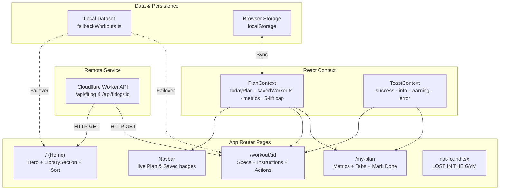

</details>

<div align="center"></div>

## 🛠️ Tech Stack

<div align="center">


</div>

| Layer | Technology | Version | Why It Is Used |
| :--- | :--- | :--- | :--- |
| **Framework** | Next.js | `16.3.6` | App Router for dynamic routing (`/workout/[id]`), layouts, and image handling. |
| **UI Library** | React | `19.2.8` | Context state, memoized selectors, hydration-safe client components. |
| **Language** | TypeScript | `5.x` | Typed `Workout` and `SortOption` models, context payloads, component props. |
| **Styling** | Tailwind CSS | `v4` | Utility-first CSS via `@tailwindcss/postcss`, dark tokens, responsive grid. |
| **Utilities** | clsx · tailwind-merge | `^2.1.1` · `^3.0.2` | Conditional class names and conflict resolution between utilities. |
| **Icons** | lucide-react | `^1.16.0` | SVG icons for equipment, metrics, navigation and actions. |
| **Interactions** | canvas-confetti | `^1.9.4` | Particle burst on set completion. |
| **Typography** | Oswald · Inter | `next/font/google` | Condensed uppercase display type paired with a legible interface face. |
| **Deployment** | Netlify | Production | Continuous deployment with `@netlify/plugin-nextjs` via `netlify.toml`. |

<div align="center"></div>

## 📂 Project Structure

<details>
<summary><strong>📁 Project Structure Tree</strong></summary>

<br />

```plaintext
B14-A6-Fit-Log/
├── public/
│   └── assets/                     # Served static images (banner.png, logo.png)
├── src/
│   ├── app/
│   │   ├── layout.tsx              # Root shell, fonts, Toast + Plan providers
│   │   ├── page.tsx                # Home page: Hero + LibrarySection
│   │   ├── not-found.tsx           # Custom 404 "LOST IN THE GYM"
│   │   ├── my-plan/
│   │   │   └── page.tsx            # Metrics cards, dual tabs, mark done, reset
│   │   └── workout/
│   │       └── [id]/
│   │           └── page.tsx        # Two-column detail view
│   ├── components/
│   │   ├── Navbar.tsx              # Sticky header, live badges, mobile menu
│   │   ├── Hero.tsx                # Banner, eyebrow, CTA anchored to #library
│   │   ├── LibrarySection.tsx      # 3x4 grid + Sort By dropdown
│   │   ├── WorkoutCard.tsx         # Tags, equipment line, stats row
│   │   ├── EmptyState.tsx          # NOTHING HERE YET placeholder + CTA
│   │   └── Footer.tsx              # Brand mark and copyright
│   ├── context/
│   │   ├── PlanContext.tsx         # Plan + saved state, metrics, cap, storage
│   │   └── ToastContext.tsx        # Toast provider and usePlan-style hook
│   ├── data/
│   │   └── fallbackWorkouts.ts     # 12-lift failover dataset + API_BASE_URL
│   └── types/
│       └── workout.ts              # Workout interface, SortOption union
├── assets/                         # README media (GIFs, animated SVGs, art)
├── UI/
│   ├── Fit Log.fig                 # Figma source
│   └── Fit Log.penpot              # Penpot source
├── netlify.toml                    # Build command, Node 20, Next.js plugin
├── next.config.ts                  # Next.js configuration
├── postcss.config.mjs              # Tailwind CSS v4 PostCSS pipeline
├── tsconfig.json                   # Compiler options and path aliases
└── package.json                    # Dependencies and scripts
```

</details>

<div align="center"></div>

## 📡 API Reference

Two endpoints, served by a Cloudflare Worker:

| Method | Endpoint | Returns |
| :--- | :--- | :--- |
| `GET` | `https://api.abcz.workers.dev/api/fitlog` | All 12 workouts |
| `GET` | `https://api.abcz.workers.dev/api/fitlog/:id` | One workout by numeric id |

<details>
<summary><strong>📦 Sample Response Object</strong></summary>

<br />

```json
{
  "id": 1,
  "name": "Barbell Bench Press",
  "image": "https://img.magnific.com/free-photo/portrait-anime-character-doing-fitness-exercising_23-2151666664.jpg?w=740",
  "muscleGroups": ["Chest", "Arms"],
  "equipment": "Barbell, Bench",
  "difficulty": "Intermediate",
  "duration": 25,
  "caloriesBurned": 180,
  "sets": 4,
  "reps": "6-8",
  "rating": 4.8,
  "description": "A compound press that builds chest thickness, triceps, and pressing power from a stable bench.",
  "instructions": [
    "Lie on the bench with eyes under the bar and feet planted.",
    "Unrack with locked elbows and lower the bar to mid-chest.",
    "Press up in a slight arc until elbows lock without bouncing.",
    "Keep shoulder blades pinched and a natural arch in the back."
  ]
}
```

</details>

**Failover sequence**

1. The request goes out with `{ cache: "no-store" }` so nothing stale is served.
2. A non-OK status or a thrown request hits the catch handler.
3. The page hydrates from [`fallbackWorkouts.ts`](src/data/fallbackWorkouts.ts) and warns in the console — no blank screen, no unhandled exception.

<div align="center"></div>

## 🎨 Design System

<details>
<summary><strong>🎨 Color Tokens and Typography</strong></summary>

<br />

| Token | Hex | Applied To |
| :--- | :--- | :--- |
| Accent Lime | `#ccff00` | Primary buttons, active tabs, progress bars, confetti, badges |
| Obsidian | `#090a0d` | Page background, text on lime surfaces |
| Graphite | `#12141a` | Card surfaces, metric panels |
| Elevated | `#181c25` | Secondary buttons, icon wrappers, hover states |
| Border | `#1f232b` | Dividers, card outlines, table rules |
| Text Primary | `#ffffff` | Headings, values, card titles |
| Text Muted | `#9ca3af` | Subtitles, descriptions, specification labels |

**Typography**

- **Oswald** via `next/font/google` — condensed uppercase display type for headings, hero copy and button labels.
- **Inter** via `next/font/google` — interface face for body copy, instructions and specification tables.

</details>

<div align="center"></div>

## 🚀 Getting Started

**Prerequisites** — Node.js `18.17+` (20 recommended), npm, and Git.

### 1. Clone the repository
```bash
git clone https://github.com/mahfuzhasan2700/Assignment-6.git
```

### 2. Navigate to the project directory
```bash
cd Assignment-6/B14-A6-Fit-Log
```

### 3. Install dependencies
```bash
npm install
```

### 4. Run the development server
```bash
npm run dev
```

Then open **[http://localhost:3000](http://localhost:3000)** in your browser.

### 5. Production build and verification
```bash
npm run lint
```

```bash
npm run build
```

```bash
npm start
```

<div align="center"></div>

## 📱 Responsive Behavior

| Viewport | Layout |
| :--- | :--- |
| **Mobile** `< 640px` | Single-column hero, grid and detail view. Navbar collapses to a slide-down menu, plan badges stay reachable. |
| **Tablet** `640–1024px` | Library grid drops to 2 columns, telemetry cards sit side by side with proportional padding. |
| **Desktop** `> 1024px` | Full 3×4 library grid, two-column detail inspection, full-width sticky header with live counters. |

<div align="center"></div>

## 📄 Author & License

- **Author** — Mahfuz Hasan ([@mahfuzhasan2700](https://github.com/mahfuzhasan2700))
- **License** — MIT. A `LICENSE` file still needs to be added to the repository root.

<div align="center">

<br />


</div>
